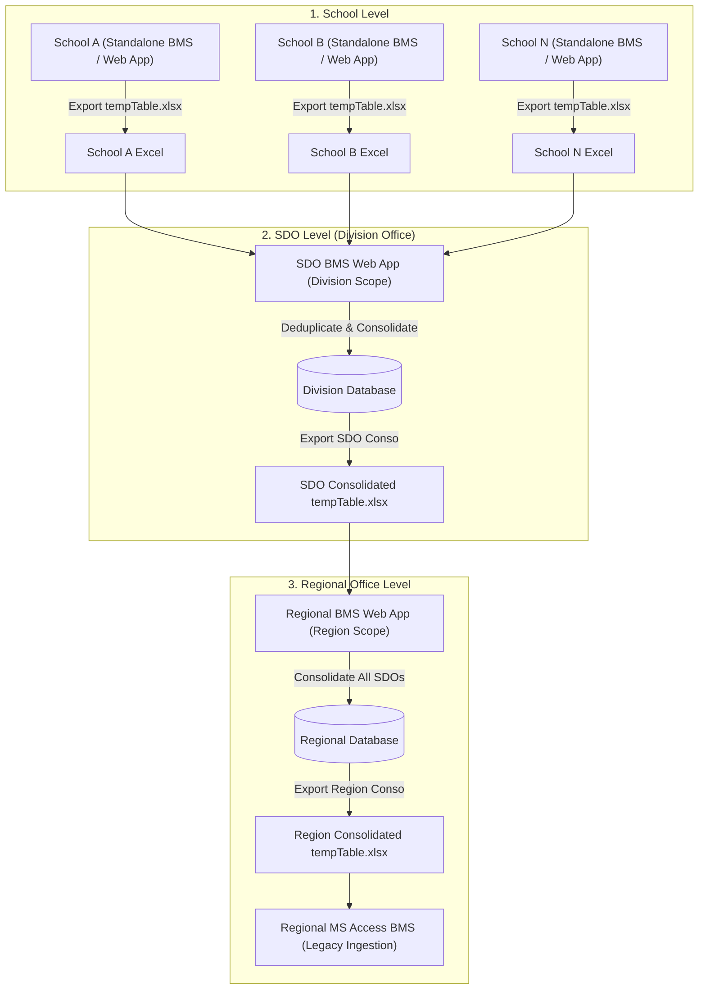
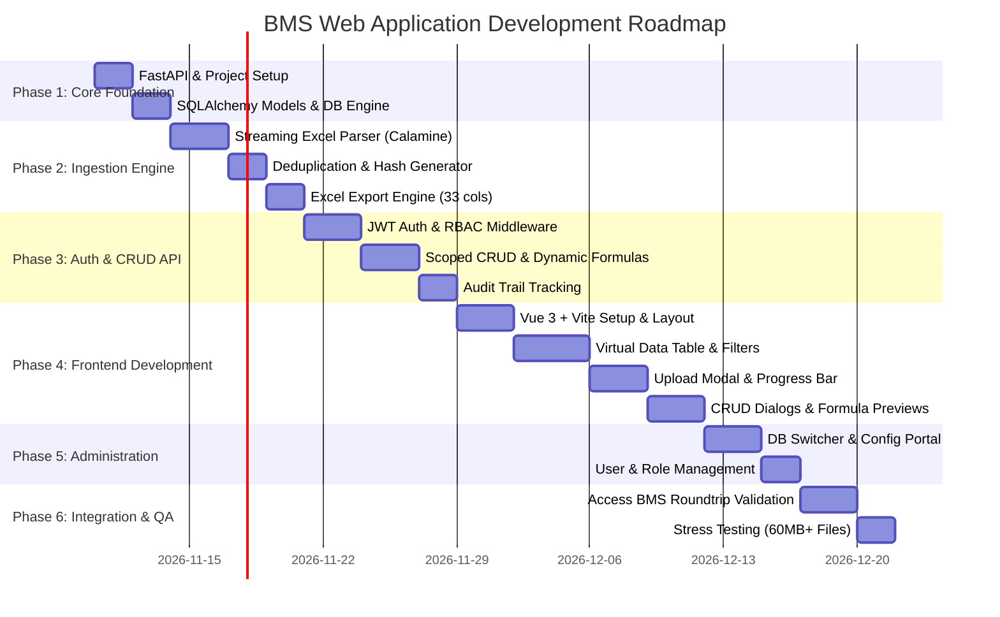
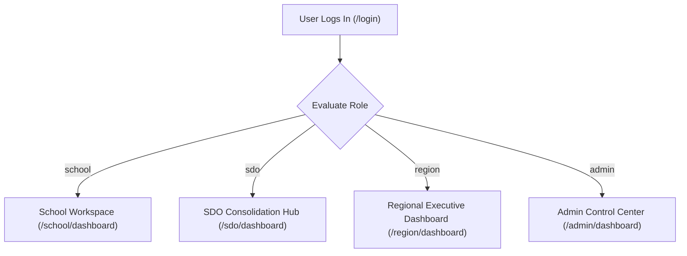

# BMS Web Application — Project Plan & Specification

## 1. Executive Summary & Objective

The **Budget Monitoring System (BMS) Web Application** is a decentralized, secure, and high-performance financial data management platform designed for the Department of Education (DepEd) hierarchy. 

Currently, schools, Schools Division Offices (SDOs), and Regional Offices (ROs) utilize a standalone Microsoft Access application named **BMS**. Data is exchanged hierarchically via exported Excel files named `tempTable` (specifically containing a sheet named `Combine Sheet` with 33 standardized columns).

This project modernizes this workflow by delivering an online, role-scoped web application that provides:
1. **Full CRUD Operations** for budget and transaction line items.
2. **High-Performance Ingestion & Export Engine** capable of reading and generating exact replica `tempTable` Excel files (even files exceeding 60MB / 100,000+ rows).
3. **Decentralized-First Architecture with Dynamic Database Switching** (starting with local SQLite/MySQL, switchable via UI settings to remote internal/cloud databases).
4. **Hierarchical Role-Based Access Control (RBAC)** ensuring data isolation between School, SDO, and Regional Office tiers.
5. **Strict Deduplication & Audit Integrity** (deterministic line fingerprinting, soft deletes, and full change logging).
6. **Dynamic Balance Calculations** (ensuring calculated columns are derived on-the-fly without database redundancy).

---

## 2. Organizational Context & Data Flow

---

## 3. Core Functional Requirements

### 3.1. Role-Based Access Control (RBAC) & Data Scoping
Every user belongs to an account assigned one of three operational roles:
- **`School` Role**:
  - Bound to a specific **School Name** (`OperatingUnit`).
  - Permissions: Can view, create, edit, soft-delete, and export records **only** for their assigned school.
- **`SDO` Role**:
  - Bound to a specific **Division Name** (`Division`).
  - Permissions: Can view, create, edit, soft-delete, and export records for **all schools under their division**.
- **`Region` Role**:
  - Bound to a specific **Region Name** (`Region`).
  - Permissions: Can view, create, edit, soft-delete, and export records for **all schools across all SDOs within their region**.
- **`SuperAdmin`**:
  - Unrestricted system-wide access, user account management, and database configuration switcher.

### 3.2. Data Ingestion & Deduplication
- **Hybrid Ingestion**:
  - **Self-Service**: School users can log in and upload their individual school `tempTable.xlsx`.
  - **Batch Ingestion**: SDO and Regional officers can drag-and-drop multiple Excel files simultaneously for batch consolidation.
- **Unique Identification & Deduplication**:
  - Native Access BMS exports lack a persistent row ID.
  - The application computes a deterministic cryptographic hash (`row_hash` using SHA-256) of core business fields:
    $$\text{row\_hash} = \text{SHA-256}(\text{OperatingUnit} + \text{DateBMS} + \text{AccountCode} + \text{UACSPAPCODE} + \text{Particulars} + \text{Obligations} + \text{Disbursement} + \text{Appropriations} + \text{Allotment} + \text{FundSource} + \text{DVAmount})$$
  - On upload: Any row matching an existing non-deleted `row_hash` is treated as a duplicate and skipped, ensuring idempotency.
- **Audit Columns & Soft Delete**:
  - All tables include: `created_on`, `created_by`, `edited_on`, `edited_by`, `deleted_on`, `deleted_by`, `is_deleted`.
  - Records are never hard deleted from the database; deletions toggle `is_deleted = 1` and stamp audit metadata.

### 3.3. Dynamic Calculations (No Database Redundancy)
The database stores only the 28 raw transaction fields. The 5 calculated balance columns are dynamically derived at runtime:
1. **`TOTAL ADJUSTED APPRO`** = `Appropriations` + `ApproAdjust`
2. **`TOTAL ADJUSTED ALLOTMENT `** = `Allotment` + `Realignment` + `TransferFrom` - `TransferTo`
3. **`UNOBLIGATED`** = `TOTAL ADJUSTED ALLOTMENT` - `ObligationsIncurred`
4. **`UNPAID`** = `ObligationsIncurred` - `Disbursement`
5. **`UNRELEASED`** = `TOTAL ADJUSTED APPRO` - `TOTAL ADJUSTED ALLOTMENT`

### 3.4. Dynamic Database Connection Switcher
- **Decentralized Local Phase**: Starts out-of-the-box using local SQLite (`bms_local.db`) or local MySQL in XAMPP (`localhost:3306`).
- **External Database Switcher**:
  - In-app configuration portal under Admin Settings.
  - Configure target driver (SQLite, MySQL/MariaDB, PostgreSQL, Cloud DB).
  - "Test Connection" button validates network latency and credentials.
  - "Run Migration" applies SQLAlchemy/Alembic schema migrations to target server automatically.

---

## 4. Architecture & Technology Stack

| Component | Technology | Rationale |
| :--- | :--- | :--- |
| **Backend Language & Framework** | **Python 3.10+ / FastAPI** | High concurrency, Rust-based validation (Pydantic v2), automatic OpenAPI documentation, clean separation of concerns. |
| **Database ORM** | **SQLAlchemy 2.0 (Async/Sync)** | Database-agnostic dialect abstraction. Enables seamless switching between SQLite, MySQL, and PostgreSQL without code changes. |
| **Streaming Excel Engine** | **`python-calamine` / `openpyxl` streaming** | Calamine (Rust engine) reads 60MB+ Excel files in seconds with under 100MB RAM, bypassing Python memory bloat. |
| **Frontend Framework** | **Vue 3 (`<script setup>`) + Vite** | Lightweight, responsive, reactive UI. Integrates cleanly with REST APIs. Familiar to team. |
| **Styling & Components** | **Tailwind CSS + Ionic UI / Lucide Icons** | Mobile/tablet responsive design, clean administrative dashboard, and accessible form controls. |
| **Packaging & Deployment** | **Self-Contained Unified Service** | FastAPI serves the compiled Vue frontend (`dist/`), allowing the entire application to run as a single executable or local service on port 8000/8080 without needing complex multi-server infrastructure. |

---

## 5. Phased Implementation Roadmap

### Milestone Deliverables & Acceptance Criteria

#### Milestone 1: Data Engine & Streaming Ingestion (COMPLETED - PHASE 1 & 2)
- [x] Database schema initialized with all 28 raw business fields, UUID primary keys, and audit columns.
- [x] Ingestion script processes Excel files with streaming Calamine engine without memory crashes.
- [x] Deduplication engine correctly identifies and skips existing identical rows based on `row_hash`.

#### Milestone 2: Scoped REST API & Dynamic Balances (COMPLETED - PHASE 3)
- [x] Role-based endpoints restrict School, SDO, and Region users to their permitted scope.
- [x] Balance calculations (`UNOBLIGATED`, `UNPAID`, etc.) correctly computed on API delivery and Excel export.
- [x] Soft deletion and audit trail functional across all mutation routes.

#### Milestone 3: Interactive Frontend (Vue 3 + Tailwind/Ionic) (COMPLETED - PHASE 4)
- [x] High-density data table rendering thousands of rows with instant client/server filtering.
- [x] Single and multi-file drag-and-drop upload modal with progress and duplicate stats.
- [x] In-line / Modal CRUD editor with live preview of computed balances.

#### Milestone 4: Database Connection Switcher & Access BMS Verification (COMPLETED - PHASE 5 & 6)
- [x] Backend API allows seamless connection testing and switching between local SQLite, local XAMPP MySQL, and remote servers.
- [x] Exported `.xlsx` verified to have exact 33 columns and `Combine Sheet` for MS Access BMS import.
- [x] Admin UI frontend component for database switching.
- [x] End-to-end roundtrip integration test verified across 16 automated tests.

---

## 6. Role-Based Workspaces & Dynamic Redirection (Phases 7–12)

### Phase 7: Dynamic Redirection & Navigation Guards (COMPLETED)
- [x] Post-login automatic redirection by role (`school`, `sdo`, `region`, `admin`).
- [x] Route-level permission guards (`meta: { roles: [...] }`) with automatic fallback to role dashboard.
- [x] Dynamic top navigation bar rendering only role-relevant views.

### Phase 8: School Workspace (`/school/dashboard`) (COMPLETED)
- [x] Backend School Summary API (`/api/v1/analytics/school-summary`).
- [x] School financial health KPI cards (Allotment, Obligations, Disbursements, Unobligated, Unpaid).
- [x] Quick actions: "Upload tempTable", "Add Line Item", "Export School Records".
- [x] School-specific transaction table.

### Phase 9: SDO Consolidation & Compliance Hub (`/sdo/dashboard`) (COMPLETED)
- [x] Backend Division Analytics API (`/api/v1/analytics/division-summary`).
- [x] Division KPI Summary banner & % Utilization progress.
- [x] School Submission & Compliance Tracker (Status matrix of all schools under the division).
- [x] Division-wide consolidation & MS Access export action.

### Phase 10: Regional Office Executive Dashboard (`/region/dashboard`) (COMPLETED)
- [x] Backend Regional Analytics API (`/api/v1/analytics/region-summary`).
- [x] NCR macro executive KPIs (Total Budget, Released, Obligations, Disbursements, % Utilization).
- [x] 16-Division comparative leaderboard table with drill-down capability.
- [x] Master 208k+ row regional consolidation export.

### Phase 11: Admin Operations Control Center (`/admin/dashboard`) (COMPLETED)
- [x] Database engine & connection health monitor.
- [x] Account directory overview & quick access to `/users` and `/settings`.
- [x] System activity & ingestion logs.

### Phase 12: Testing & Security Verification (COMPLETED)
- [x] Automated role-guard and permission tests.
- [x] End-to-end multi-role login and data scoping verification.

